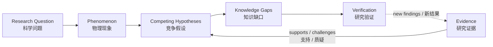

# Fusion Research Atlas (FRA) | 聚变科学问题与证据图谱

**Make the real scientific questions of fusion visible. Connect disciplines. Advance understanding through evidence.**\
**让真实的聚变科学问题被看见，让不同学科汇聚，以科学证据推动认识与突破。**

[**Explore the Atlas · 探索图谱**](https://zwy-research.github.io/Fusion-Research-Atlas/) · [**Contribute a Question or Idea · 参与研究**](https://github.com/ZWY-research/Fusion-Research-Atlas/issues/new/choose) · [**Contribution Guide · 贡献指南**](CONTRIBUTING.md) · [**Research Insights · 科研成果解读**](docs/literature/README.md)

> **EN** — Fusion is a scientific challenge shared by humanity. Many of its hardest problems lie at the intersection of disciplines. Fusion Research Atlas (FRA) is an open, collaborative, evidence-driven and evolving fusion research platform to expose the questions that matter, trace what the evidence actually shows, identify what remains unexplained, and invite researchers from different fields to develop and test new explanations together.
>
> **中文** — 聚变研究是人类共同面对的重大科学挑战，许多关键困难位于不同学科的交汇处。Fusion Research Atlas（FRA）是一个开放协作、科学证据驱动、持续演化的聚变科学研究平台：将真正重要的科学问题清晰呈现出来，追踪证据究竟支持什么、尚有哪些现象无法解释，并吸引不同专业背景的研究者共同提出和检验新的科学解释。

**EN** Curiosity opens new scientific questions; evidence and collaboration turn them into progress.

**中文** 好奇心让科学不断提出新的问题，证据与合作让探索逐步转化为进步。

## Why this project exists | 为什么需要 FRA？

**EN** Fusion energy is a shared scientific endeavour with potential long-term value for energy supply, energy security, low-carbon development, and humanity's scientific and technological capabilities. Growing energy needs and the time required to develop and validate complex technologies make sustained research urgent. National programmes and international collaborations are strengthening the effort, while practical fusion power still requires major advances in basic science, engineering, and reliable operation.

**中文** 聚变能源是人类共同探索的科学事业，对长期能源供给、能源安全、低碳发展以及未来科学技术能力具有潜在价值。持续增长的能源需求与复杂技术研发、验证所需的长期投入，使聚变研究具有现实紧迫性。各国研究计划与国际合作正在加强相关投入，而实现实用化聚变发电仍需要基础科学、工程技术和可靠运行方面的重大进展。

### International research context | 国际研究背景

**EN** The following official documents illustrate the wider research and policy context. They describe research priorities and ambitions, rather than evidence that commercial fusion power has already been achieved.

**中文** 以下官方文件呈现相关科研与政策背景，反映研究重点和发展目标，不代表商业聚变发电已经实现。

| Official source / 官方来源                                                                                                                                                                                                                                                                                                                                                                        | Date and relevant scope / 时间与相关内容                                                                                                                                                                                                                                                                                                                                                        |
| ------------------------------------------------------------------------------------------------------------------------------------------------------------------------------------------------------------------------------------------------------------------------------------------------------------------------------------------------------------------------------------------------- | ----------------------------------------------------------------------------------------------------------------------------------------------------------------------------------------------------------------------------------------------------------------------------------------------------------------------------------------------------------------------------------------------- |
| U.S. White House Office of Science and Technology Policy, [Science: A New Golden Age](https://www.whitehouse.gov/science/) / 美国白宫科技政策办公室                                                                                                                                                                                                                                               | July 2026; the transmittal letter is dated 21 July. Discusses interdisciplinary research, scientific publication, verification, and new forms of collaboration; a report on the research system, rather than a dedicated fusion technology white paper. / 2026 年 7 月，呈报信日期为 7 月 21 日。涉及跨学科研究、科学发表、验证与新型协作，是科研体系报告，并非专门的聚变技术白皮书。           |
| U.S. Department of Energy, [Fusion Science and Technology Roadmap](https://www.energy.gov/documents/fusion-science-and-technology-roadmap) / 美国能源部                                                                                                                                                                                                                                           | Published June 2026. Identifies science and technology gaps, milestones, and infrastructure needs across confinement, materials, plasma-facing components, fuel cycles, blankets, and plant integration. / 2026 年 6 月发布，梳理约束、材料、面向等离子体部件、燃料循环、包层和电站集成等方向的科技缺口、里程碑及基础设施需求。                                                                 |
| China, Outline of the 15th Five-Year Plan for National Economic and Social Development (2026–2030) / 《中华人民共和国国民经济和社会发展第十五个五年规划纲要》：[CPPCC republication / 全国政协转载](https://www.cppcc.gov.cn/zxww/2026/03/16/ARTI1773644951646391.shtml), [NDRC official text / 国家发展改革委原文](https://www.ndrc.gov.cn/fggz/fzzlgh/gjfzgh/202603/U020260317369114704096.pdf) | March 2026; NDRC republication dated 17 March. Chapter 5, section 2 (PDF page 19) includes fusion energy in the development of future industries. The NDRC text provides an alternative official source when the CPPCC page is unavailable. / 2026 年 3 月，发改委转载日期为 3 月 17 日；第五章第二节（PDF 第 19 页）将核聚变能列入未来产业发展方向；政协网页不可访问时，可查阅发改委官方原文。 |
| China, [Atomic Energy Law of the People's Republic of China / 《中华人民共和国原子能法》](https://www.caea.gov.cn/n6760338/n6760342/c10704020/content.html) ([alternative official text / 官方备用原文](https://www.caea.gov.cn/n6760338/n6760344/n10763762/n10763767/c10704020/content.html))                                                                                                    | Adopted 12 September 2025. Article 14 encourages and supports scientific research and technological development in controlled thermonuclear fusion. / 2025 年 9 月 12 日通过，第十四条明确鼓励和支持受控热核聚变的科学研究与技术开发。                                                                                                                                                          |

**EN** These sources provide context for FRA's mission; their inclusion does not imply institutional endorsement, affiliation, or funding of FRA.

**中文** 上述资料仅作为 FRA 使命的背景，引述不意味着 FRA 获得有关机构的官方支持、隶属关系或资助。

### Shared scientific difficulties | 共同科学困难

**EN** Practical fusion depends on coupled advances in plasma confinement and stability; turbulence and particle, heat, and momentum transport; nonlinear and multiscale dynamics; heating and current drive; plasma–wall interaction and extreme-environment materials; heat exhaust; burning plasmas and energetic particles; tritium fuel cycles; diagnostics, prediction, and control; and system integration. These difficulties extend across fusion approaches and are closely interdependent. Complex experimental conditions, restricted model applicability, quantities that are difficult to observe, and differences between simulations and measurements make evidence difficult to interpret and transfer between systems.

**中文** 实用化聚变依赖多个相互耦合方向的进展：等离子体约束与稳定性，湍流及粒子、能量与动量输运，非线性与多尺度动力学，加热和电流驱动，等离子体与壁相互作用及极端环境材料，热排出，燃烧等离子体与高能粒子，氚燃料循环，诊断、预测与控制，以及系统集成。这些困难广泛存在于不同聚变路线，并相互依赖。复杂的实验条件、模型适用边界、难以直接观测的物理量，以及模拟与测量之间的差异，使证据的解释和跨系统应用具有挑战性。

### Connecting evidence and expertise | 连接科学证据与研究能力

**EN** Papers, conferences, and large collaborations effectively communicate specialised results. Yet the conditions, assumptions, evidence, and interpretations needed to compare those results remain distributed across publications, devices, models, and communities. Researchers entering from another discipline can struggle to determine what was actually observed, how well an explanation is supported, whether apparently conflicting findings concern comparable conditions, and which unresolved difficulty can become an executable research task. A mathematician, fluid dynamicist, statistician, computational scientist, or machine-learning researcher may have useful methods without a clear route into the physical problem.

**中文** 论文、会议和大型合作项目能够有效传播专业成果，但比较这些成果所需的条件、假设、证据和解释仍分散在不同文献、装置、模型及研究群体中。其他学科的研究者往往难以迅速判断实验实际观测了什么、解释得到何种程度的支持、看似冲突的结果是否具有可比条件，以及哪项未解决的困难能够转化为可执行的研究任务。数学、流体力学、统计学、数值计算或机器学习研究者可能拥有有效方法，却缺少进入具体物理问题的清晰路径。

**EN** FRA aims to complement these channels with an open research platform organised around scientific questions. It connects phenomena, existing knowledge, competing mechanisms, assumptions, supporting and challenging evidence, unresolved gaps, and verification methods in a traceable network. It should show how far current explanations reach, make promising mechanisms and new hypotheses explicit, and turn suitable fusion questions into more general problems in mathematics, nonlinear dynamics, numerical analysis, statistical inference, and systems science. Such abstraction must preserve the original physical conditions and model assumptions; proposed answers must ultimately be tested in the relevant fusion system. New evidence should continuously update the network and enable researchers worldwide to work on the same problem.

**中文** FRA 希望通过以科学问题为中心的开放研究平台补充这些交流渠道，将现象、已有认识、竞争机制、假设、支持与质疑证据、尚未解决的困难和验证方法连接为可追溯网络。平台应说明现有解释究竟覆盖到什么程度，明确值得探索的机制与新假设，并将适合跨学科研究的聚变问题转化为数学、非线性动力学、数值分析、统计推断和系统科学中的一般问题。抽象过程必须保留原始物理条件及模型假设，提出的答案最终仍须回到相应聚变系统中检验。新证据应持续更新这一网络，使全球不同专业的科研人员能够共同研究同一问题。

### Why start with particle transport? | 为什么从粒子输运开始？

**EN** The first in-depth case is core electron-density transport and density peaking in tokamak plasmas. The project's initiator has relevant experimental and theoretical research experience, allowing a real research case to test FRA's scientific methods, evidence organisation, and collaboration mechanisms. The original graph records retain demonstration status while separately labelled research records develop. This starting point does not limit FRA to tokamaks or particle transport: its long-term scope spans different fusion science and technology directions.

**中文** 首个深入研究案例是托卡马克核心电子密度输运及密度峰化。项目发起者具有相关实验与理论研究经验，可利用真实研究案例检验 FRA 的科研方法、科学证据组织方式和协作机制。原有图谱记录保留演示状态，新增科研记录单独标识。这一起点不意味着 FRA 仅研究托卡马克或粒子输运，其长期范围涵盖不同聚变科学和技术方向。

## Respecting contributions and working together | 尊重科研贡献，共同探索

**EN** FRA respects each research contribution and its authors. We select representative studies because their observations, methods, evidence, or ideas help address an important fusion question. Research Insights explain why a study deserves attention, what its authors contributed, how it advances understanding, and what new connections and open questions invite further work. Applicability limits and unresolved questions help build on a contribution. They should be read in the context of the experimental capabilities, theory, and computing resources available when the work was done.

**中文** FRA 尊重每项科研成果及其作者。我们选择有代表性的研究，是因为其观测、方法、证据或思想有助于回答重要的聚变科学问题。科研成果解读说明研究为何值得关注、作者实际作出的贡献、相关认识如何得到推进，以及哪些新联系和开放问题值得继续探索。辨明适用边界和未解问题，有助于在已有贡献上继续研究，也应结合研究开展时的实验能力、理论认识与计算条件理解。

**EN** FRA's role is constructive scientific learning, discussion, research, and collaboration. It does not act as a journal referee or assign pass/fail decisions or academic grades. Authors and researchers from other disciplines are welcome to correct interpretations, clarify original conditions, add overlooked contributions or new evidence, propose alternative explanations, and develop questions together through the [existing Issue forms and Pull Requests](CONTRIBUTING.md).

**中文** FRA 用于建设性的科学学习、交流、研究与合作，不扮演期刊审稿人，不作通过、未通过或学术等级裁决，也不以个人或学术攻击为目的。欢迎原论文作者及其他学科研究者通过[现有 Issue 表单和 Pull Request](CONTRIBUTING.md)修正解读、澄清原始条件、补充未充分呈现的贡献或新证据、提出替代解释，并共同发展新的研究问题。

## The questions we want to make visible | 我们希望呈现什么？

| English                                                                                                                    | 中文                                                                    |
| -------------------------------------------------------------------------------------------------------------------------- | ----------------------------------------------------------------------- |
| **What happens?** Which physical phenomena have actually been observed or reproduced?                                      | **观察到了什么？** 哪些物理现象确实得到实验观测或模拟复现？             |
| **What do we understand?** Which explanations are established, conditional, or disputed?                                   | **已经理解了什么？** 哪些解释已有充分依据，哪些依赖特定条件或仍有争议？ |
| **What is missing?** Where do models, measurements, and experiments disagree?                                              | **真正缺少什么？** 模型、诊断与实验之间有哪些差异或证据空白？           |
| **Could another discipline help?** Which mathematical, computational, or experimental approaches might unlock progress?    | **哪些学科可以提供突破？** 哪些数学、计算或实验方法值得引入？           |
| **How can we find out?** What prediction, measurement, simulation, or derivation would distinguish competing explanations? | **下一步如何验证？** 哪种预测、测量、模拟或推导能够区分竞争解释？       |

### From questions to testable research | 从科学问题走向可检验的研究



**EN** Every important claim should be connected to its physical conditions, assumptions, original sources, and level of verification. New findings can strengthen, qualify, challenge, or replace earlier interpretations.

**中文** 重要科学主张应当能够追溯至具体物理条件、模型假设、原始资料和核验程度。随着新研究出现，既有解释可以得到支持、被限制适用范围、受到质疑，或被更好的解释替代。

## Fusion research goes beyond one topic | 研究范围不局限于单一问题

FRA currently organizes research across eight domains / FRA 当前按八个领域组织科学问题：

| Scientific domain                   | 科学领域                 |
| ----------------------------------- | ------------------------ |
| Particle, Heat & Momentum Transport | 粒子、能量与动量输运     |
| Turbulence & Microinstabilities     | 湍流与微观不稳定性       |
| MHD & Plasma Stability              | MHD 与等离子体稳定性     |
| Heating & Current Drive             | 加热与电流驱动           |
| Edge & Plasma-Wall Interaction      | 边界与等离子体壁相互作用 |
| Burning Plasma Physics              | 燃烧等离子体物理         |
| Plasma Diagnostics & Measurements   | 等离子体诊断与测量       |
| Integrated Modeling & Control       | 集成建模与等离子体控制   |

**EN** The initial demonstration case is **q-density: What determines core electron-density peaking in tokamak plasmas?** It is a first test of the method, **not a boundary on the project's ambition**. Other fusion problems and confinement approaches may be developed as evidence and contributors become available. The current site does not yet contain completed research atlases for all eight domains.

**中文** 初始演示案例是 **q-density：什么机制决定托卡马克核心电子密度峰化？** 这一案例用于检验研究方法，**不代表项目只研究密度输运**。随着新证据与贡献者加入，图谱可拓展到其他聚变科学问题及约束方式。当前网站尚未完成八个领域各自的真实研究子图。

## A place for researchers from many disciplines | 不同学科都可以参与

| Your background / 专业背景                                                      | Where you might contribute / 可能贡献的方向                                                                                                                 |
| ------------------------------------------------------------------------------- | ----------------------------------------------------------------------------------------------------------------------------------------------------------- |
| Plasma physics & fusion engineering / 等离子体物理与聚变工程                    | Identify important phenomena, interpret experiments, compare physical mechanisms / 提出现象、解释实验、比较机制                                             |
| Fluid mechanics, turbulence & nonlinear dynamics / 流体力学、湍流与非线性动力学 | Analyze transport, instability, nonlinear coupling, bifurcation, and multiscale behavior / 研究输运、不稳定性、非线性耦合、分岔与多尺度行为                 |
| Mathematics & numerical analysis / 数学与数值分析                               | Develop derivations, counterexamples, stability analyses, uncertainty bounds, and solvers / 开展数学推导、反例、稳定性分析、误差评估与算法研究              |
| Computer science, AI & data science / 计算机科学、人工智能与数据科学            | Build reproducible simulations, analyze datasets, investigate interpretable models, improve research tools / 开展可复现模拟、数据分析、可解释建模与工具开发 |
| Materials, diagnostics & instrumentation / 材料、诊断与仪器                     | Connect material response and measurement limitations to physical questions / 研究材料响应、测量能力与物理问题的联系                                        |
| Control theory & systems engineering / 控制理论与系统工程                       | Formulate predictive, observable, and controllable research problems / 研究状态预测、可观测性、可控性与反馈策略                                             |

**EN** You do **not** need to be a tokamak specialist, write frontend code, or already know the answer to participate. A precise open question, a well-supported criticism, or an independently testable idea can be valuable.

**中文** **不需要先成为托卡马克专家、不需要会写前端代码，也不需要已经掌握答案。** 一个定义清楚的开放问题、一条有证据支持的质疑，或一个可以独立检验的研究想法，都可能成为有价值的贡献。

## How to contribute | 如何参与？

Start with the [**GitHub contribution forms / GitHub 贡献入口**](https://github.com/ZWY-research/Fusion-Research-Atlas/issues/new/choose). You can contribute in English or Chinese / 可使用英文或中文提交讨论材料。

| Contribution route        | 参与方式           | A useful first contribution / 第一次可以做什么                                                                                                           |
| ------------------------- | ------------------ | -------------------------------------------------------------------------------------------------------------------------------------------------------- |
| **Research Question**     | 提出科学问题       | Describe an unexplained observation and why it matters / 描述尚未解释的现象及其重要性                                                                    |
| **Evidence Contribution** | 提供研究证据       | Share a traceable paper or public result, identifying the actual finding and conditions / 提供可追溯论文或公开结果，说明具体发现与条件                   |
| **Scientific Challenge**  | 提出科学质疑       | Identify an assumption, counterexample, conflicting result, or model limitation / 指出隐含假设、反例、矛盾结果或模型局限                                 |
| **Verification Proposal** | 提出验证方案       | Suggest a calculation, experiment, parameter scan, or discriminating prediction / 提出计算、实验、参数扫描或可区分竞争解释的预测                         |
| **Pull Request**          | 提交代码或内容改进 | Improve bilingual descriptions, graph data, accessibility, visualization, tests, or documentation / 完善双语内容、图谱数据、可访问性、可视化、测试或文档 |

**For a scientific contribution, the most helpful starting information is / 科学贡献最好包含：**

1. **Question / 问题：** What exactly needs explaining? / 究竟需要解释什么？
2. **Context / 条件：** Which system, parameters, and assumptions apply? / 涉及什么装置、参数及假设？
3. **Evidence / 证据：** DOI, figure, public dataset, equation, or reproducible result, if available / 如有可能，提供 DOI、图表、公开数据、方程或可复现结果。
4. **Uncertainty / 未知：** What is unresolved or potentially contradictory? / 尚未解决或存在矛盾的部分是什么？
5. **Next test / 验证：** What could confirm, reject, or distinguish explanations? / 什么方法能够支持、否定或区分不同解释？

**EN** A fully developed paper is not required to open a research discussion. If you want to change structured graph data or source code, please read the [bilingual contribution guide](CONTRIBUTING.md) before opening a pull request. Scientific disagreements are welcome when stated precisely and supported by reasoning or evidence.

**中文** 提交一个科学问题不要求先写出完整论文。如果希望直接修改图谱数据或源码，请先阅读[中英双语贡献指南](CONTRIBUTING.md)，然后提交 Pull Request。欢迎提出有明确论证或证据支持的不同科学观点。

## What is available now? | 当前项目进展

**Version / 版本： `v0.2.0` — public research-platform prototype / 已公开的科研平台原型**

| Research progress / 科研进展                                                                        | Current record / 当前记录                                                                                                                                                                                |
| --------------------------------------------------------------------------------------------------- | -------------------------------------------------------------------------------------------------------------------------------------------------------------------------------------------------------- |
| [Indexed Papers / 已收录论文](docs/literature/README.md#indexed-papers)                             | **3**                                                                                                                                                                                                    |
| [Completed Research Studies / 已完成深入研读](docs/literature/README.md#completed-research-studies) | **2**                                                                                                                                                                                                    |
| [Independently Verified / 已完成独立验证](docs/literature/README.md#independently-verified)         | **0**                                                                                                                                                                                                    |
| First research case / 首个研究案例                                                                  | [q-density: core electron-density transport and density peaking / 核心电子密度输运与密度峰化](https://zwy-research.github.io/Fusion-Research-Atlas/#q-density)                                           |
| [Research Insights / 科研成果解读](docs/literature/README.md)                                       | Eight-domain catalogue, individual paper records, and a [bilingual review template](docs/literature/REVIEW_TEMPLATE.md) / 八领域目录、单篇论文信息页及[双语评议模板](docs/literature/REVIEW_TEMPLATE.md) |

**EN** Counts describe distinct papers, not domain assignments, and reflect the current records as of 12 October 2026. Creating a paper page or checking a DOI does not count as a completed scientific review; a completed review does not itself establish independent verification.

**中文** 统计按不同论文去重，不累加领域关联次数，反映截至 2026 年 10 月 12 日的实际记录。创建论文页面或核对 DOI 不计为完成科学评议，完成评议本身也不等于独立验证。

- **EN:** The bilingual website and interactive scientific graph are available. The platform supports scientific objects, typed relationships, search, filtering, source links, and distinct evidence-verification states.\
  **中文：** 已上线中英双语网站与交互式科学图谱，支持科学对象、带语义的关系、搜索筛选、来源链接和分层证据核验状态。
- **EN:** The original 15 scientific objects and their relationships retain their **demonstration** status. Six additional **research records** connect the q-density question to the Angioni 2007 / Greenwald 2007 evidence chain, an empirical knowledge update, unresolved mechanism identification, and proposed verification. Source details link to Research Insights and retain DOI, finding IDs, and verification levels.\
  **中文：** 原有 15 个科学对象及关系继续保留**演示**状态。六个新增**科研记录**将 q-density 连接至 Angioni 2007 / Greenwald 2007 的跨论文证据链、经验认识更新、机制识别缺口和计划验证。来源详情可进入科研成果解读，并保留 DOI、发现 ID 与分层核验状态。
- **EN:** [Angioni 2007](docs/literature/papers/angioni-2007.md) has a completed study of its institutional author manuscript; [Greenwald 2007](docs/literature/papers/greenwald-2007.md) has a completed study of the journal letter's full-text extraction, including all four figure captions and Eq. (1). Figure-image access limitations are recorded. Angioni 2003 remains at metadata/abstract scope. No independent scientific verification has been performed.\
  **中文：** [Angioni 2007](docs/literature/papers/angioni-2007.md) 已完成机构作者稿研读；[Greenwald 2007](docs/literature/papers/greenwald-2007.md) 已完成原刊短文全文提取文本、四幅图注及式（1）的研读，并记录图像访问限制。Angioni 2003 仍为书目/摘要级。均未开展独立科学验证。
- **EN:** This begins the **V0.3** research milestone: cross-paper evidence now enters the interactive atlas. Stronger empirical support for a collisionality scaling does not resolve the microscopic density-peaking mechanism. The public release remains v0.2.0; these additions are submitted through a reviewable PR.\
  **中文：** 本次开始落实 **V0.3** 科研里程碑：跨论文证据已进入交互图谱。碰撞性经验定标得到更强支持，密度峰化的微观机制仍未解决。公开发布标签保持 v0.2.0，新增内容通过可审查的 PR 提交。

**EN** A successful software build does not establish a scientific mechanism. FRA explicitly separates source metadata, abstract/full-text reading, claim assessment, and independent verification.\
**中文** 软件构建成功不代表物理机制得到证明。FRA 严格区分书目信息、摘要与全文查阅、具体科学主张核验和独立科学验证。

For technical details / 技术细节：[Data & Evidence Model / 数据与证据模型](docs/data-model.md).

## Run locally | 本地运行

**EN** The current website uses React, TypeScript, Vite, Cytoscape.js, and GitHub Pages. Node.js 24 and npm are required.\
**中文** 当前网站使用 React、TypeScript、Vite、Cytoscape.js 和 GitHub Pages，开发环境需要 Node.js 24 与 npm。

```bash
npm ci
npm run dev -- --host 127.0.0.1
```

Open the local URL ending in `/Fusion-Research-Atlas/` / 打开终端给出的以 `/Fusion-Research-Atlas/` 结尾的本地地址。

Before a code or graph-data pull request / 提交代码或图谱数据 PR 前：

```bash
npm run validate:data
npm run typecheck
npm test
npm run lint
npm run build
```

For changes affecting browser interactions, additionally run `npm run test:browser` with a supported Chrome/Chromium installation / 修改浏览器交互时，还需在可用的 Chrome/Chromium 环境中运行 `npm run test:browser`。

## Open science, responsible sharing | 开放科学与负责任的共享

**EN** FRA welcomes evidence, constructive challenges, and new hypotheses. Please distinguish observed results from interpretations, preserve physical conditions and model limitations, and disclose the level of source review. Do not upload private experimental data, restricted institutional materials, credentials, or copyrighted full text and figures without permission. The repository's original code and original illustrative content are distributed under the [MIT License](LICENSE); third-party papers and datasets retain their own rights.

**中文** FRA 欢迎研究证据、建设性质疑和创新假设。请区分已观测的结果与解释，保留物理条件、模型局限和实际完成的来源核验程度。未经许可，不得上传非公开实验数据、受限单位资料、认证凭据以及受版权保护的论文全文或图片。仓库原创代码与原创示例内容依照 [MIT 许可证](LICENSE) 发布；第三方论文和数据仍遵循各自的权利与许可。

---

**EN** Fusion science advances when important questions are made explicit, evidence is open to scrutiny, and people with different expertise can work on the same problem. **Help identify a real question. Challenge an explanation. Contribute evidence. Propose a test.**

**中文** 当重要科学问题被清楚提出、证据能够接受检验、不同专业的人能够研究同一个问题时，聚变科学才更有可能持续取得进展。**欢迎提出真实问题、质疑已有解释、贡献科学证据，或设计下一项验证。**

[**Explore FRA · 探索图谱**](https://zwy-research.github.io/Fusion-Research-Atlas/) · [**Start contributing · 开始参与**](https://github.com/ZWY-research/Fusion-Research-Atlas/issues/new/choose)
