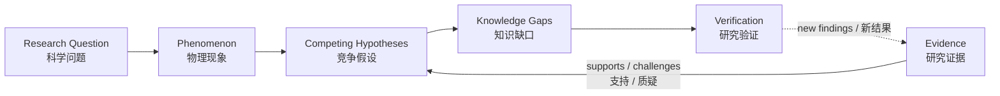

# Fusion Research Atlas (FRA) | 聚变科学问题与证据图谱

**Make the real scientific questions of fusion visible. Connect disciplines. Advance understanding through evidence.**\
**让真实的聚变科学问题被看见，让不同学科汇聚，以科学证据推动认识与突破。**

[**Explore the Atlas · 探索图谱**](https://zwy-research.github.io/Fusion-Research-Atlas/) · [**Contribute a Question or Idea · 参与研究**](https://github.com/ZWY-research/Fusion-Research-Atlas/issues/new/choose) · [**Contribution Guide · 贡献指南**](CONTRIBUTING.md)

> **EN** — Fusion is a scientific challenge shared by humanity. Many of its hardest problems lie at the intersection of disciplines. Fusion Research Atlas (FRA) is an open, collaborative, evidence-driven and evolving fusion research platform to expose the questions that matter, trace what the evidence actually shows, identify what remains unexplained, and invite researchers from different fields to develop and test new explanations together.
>
> **中文** — 聚变研究是人类共同面对的重大科学挑战，许多关键困难位于不同学科的交汇处。Fusion Research Atlas（FRA）是一个开放协作、科学证据驱动、持续演化的聚变科学研究平台：将真正重要的科学问题清晰呈现出来，追踪证据究竟支持什么、尚有哪些现象无法解释，并吸引不同专业背景的研究者共同提出和检验新的科学解释。

## Why this project exists | 为什么需要 FRA？

**EN** A researcher studying particle transport in a tokamak may need insights from turbulence theory, nonlinear dynamics, numerical analysis, statistics, or control theory. Conversely, a mathematician or computational scientist may have powerful methods but no clear view of which unresolved fusion problem could benefit from them. Similar boundaries appear throughout fusion research: plasma stability, heating, plasma–wall interactions, diagnostics, burning plasmas, and integrated control.

**中文** 研究托卡马克粒子输运的科研人员，可能需要湍流理论、非线性动力学、数值分析、统计学或控制理论的帮助。反过来，数学或计算科学研究者可能拥有有效的方法，却不了解哪些尚未解决的聚变问题可以从中受益。类似的跨学科障碍广泛存在于等离子体稳定性、加热、等离子体与壁相互作用、诊断、燃烧等离子体及集成控制等研究领域。

**EN** FRA aims to make that connection possible. It is **not just a bibliography, a collection of answers, or a visualization of papers**. It is a map of scientific problems, observations, competing physical mechanisms, supporting and conflicting evidence, and research tasks that can actually be tested.

**中文** FRA 希望打通这些联系。它**不只是文献目录、已有答案汇编或论文可视化工具**，而是将科学问题、实验现象、竞争性物理机制、支持与反对证据，以及能够实际检验的研究任务组织成相互关联的网络。

## The questions we want to make visible | 我们希望呈现什么？

| English                                                                                                                    | 中文                                                                    |
| -------------------------------------------------------------------------------------------------------------------------- | ----------------------------------------------------------------------- |
| **What happens?** Which physical phenomena have actually been observed or reproduced?                                      | **观察到了什么？** 哪些物理现象确实得到实验观测或模拟复现？             |
| **What do we understand?** Which explanations are established, conditional, or disputed?                                   | **已经理解了什么？** 哪些解释已有充分依据，哪些依赖特定条件或仍有争议？ |
| **What is missing?** Where do models, measurements, and experiments disagree?                                              | **真正缺少什么？** 模型、诊断与实验之间有哪些差异或证据空白？           |
| **Could another discipline help?** Which mathematical, computational, or experimental approaches might unlock progress?    | **哪些学科可以提供突破？** 哪些数学、计算或实验方法值得引入？           |
| **How can we find out?** What prediction, measurement, simulation, or derivation would distinguish competing explanations? | **下一步如何验证？** 哪种预测、测量、模拟或推导能够区分竞争解释？       |

### From questions to testable research | 从科学问题走向可检验的研究



**EN** Every important claim should be connected to its physical conditions, assumptions, original sources, and level of verification. New findings can strengthen, qualify, challenge, or replace earlier interpretations.

**中文** 重要科学主张应当能够追溯至具体物理条件、模型假设、原始资料和核验程度。随着新研究出现，既有解释可以得到支持、被限制适用范围、受到质疑，或被更好的解释替代。

## Fusion research goes beyond one topic | 研究范围不局限于单一问题

FRA currently organizes research across eight domains / FRA 当前按八个领域组织科学问题：

| Scientific domain                   | 科学领域                 |
| ----------------------------------- | ------------------------ |
| Particle, Heat & Momentum Transport | 粒子、能量与动量输运     |
| Turbulence & Microinstabilities     | 湍流与微观不稳定性       |
| MHD & Plasma Stability              | MHD 与等离子体稳定性     |
| Heating & Current Drive             | 加热与电流驱动           |
| Edge & Plasma-Wall Interaction      | 边界与等离子体壁相互作用 |
| Burning Plasma Physics              | 燃烧等离子体物理         |
| Plasma Diagnostics & Measurements   | 等离子体诊断与测量       |
| Integrated Modeling & Control       | 集成建模与等离子体控制   |

**EN** The initial demonstration case is **q-density: What determines core electron-density peaking in tokamak plasmas?** It is a first test of the method, **not a boundary on the project's ambition**. Other fusion problems and confinement approaches may be developed as evidence and contributors become available. The current site does not yet contain completed research atlases for all eight domains.

**中文** 初始演示案例是 **q-density：什么机制决定托卡马克核心电子密度峰化？** 这一案例用于检验研究方法，**不代表项目只研究密度输运**。随着新证据与贡献者加入，图谱可拓展到其他聚变科学问题及约束方式。当前网站尚未完成八个领域各自的真实研究子图。

## A place for researchers from many disciplines | 不同学科都可以参与

| Your background / 专业背景                                                      | Where you might contribute / 可能贡献的方向                                                                                                                 |
| ------------------------------------------------------------------------------- | ----------------------------------------------------------------------------------------------------------------------------------------------------------- |
| Plasma physics & fusion engineering / 等离子体物理与聚变工程                    | Identify important phenomena, interpret experiments, compare physical mechanisms / 提出现象、解释实验、比较机制                                             |
| Fluid mechanics, turbulence & nonlinear dynamics / 流体力学、湍流与非线性动力学 | Analyze transport, instability, nonlinear coupling, bifurcation, and multiscale behavior / 研究输运、不稳定性、非线性耦合、分岔与多尺度行为                 |
| Mathematics & numerical analysis / 数学与数值分析                               | Develop derivations, counterexamples, stability analyses, uncertainty bounds, and solvers / 开展数学推导、反例、稳定性分析、误差评估与算法研究              |
| Computer science, AI & data science / 计算机科学、人工智能与数据科学            | Build reproducible simulations, analyze datasets, investigate interpretable models, improve research tools / 开展可复现模拟、数据分析、可解释建模与工具开发 |
| Materials, diagnostics & instrumentation / 材料、诊断与仪器                     | Connect material response and measurement limitations to physical questions / 研究材料响应、测量能力与物理问题的联系                                        |
| Control theory & systems engineering / 控制理论与系统工程                       | Formulate predictive, observable, and controllable research problems / 研究状态预测、可观测性、可控性与反馈策略                                             |

**EN** You do **not** need to be a tokamak specialist, write frontend code, or already know the answer to participate. A precise open question, a well-supported criticism, or an independently testable idea can be valuable.

**中文** **不需要先成为托卡马克专家、不需要会写前端代码，也不需要已经掌握答案。** 一个定义清楚的开放问题、一条有证据支持的质疑，或一个可以独立检验的研究想法，都可能成为有价值的贡献。

## How to contribute | 如何参与？

Start with the [**GitHub contribution forms / GitHub 贡献入口**](https://github.com/ZWY-research/Fusion-Research-Atlas/issues/new/choose). You can contribute in English or Chinese / 可使用英文或中文提交讨论材料。

| Contribution route        | 参与方式           | A useful first contribution / 第一次可以做什么                                                                                                           |
| ------------------------- | ------------------ | -------------------------------------------------------------------------------------------------------------------------------------------------------- |
| **Research Question**     | 提出科学问题       | Describe an unexplained observation and why it matters / 描述尚未解释的现象及其重要性                                                                    |
| **Evidence Contribution** | 提供研究证据       | Share a traceable paper or public result, identifying the actual finding and conditions / 提供可追溯论文或公开结果，说明具体发现与条件                   |
| **Scientific Challenge**  | 提出科学质疑       | Identify an assumption, counterexample, conflicting result, or model limitation / 指出隐含假设、反例、矛盾结果或模型局限                                 |
| **Verification Proposal** | 提出验证方案       | Suggest a calculation, experiment, parameter scan, or discriminating prediction / 提出计算、实验、参数扫描或可区分竞争解释的预测                         |
| **Pull Request**          | 提交代码或内容改进 | Improve bilingual descriptions, graph data, accessibility, visualization, tests, or documentation / 完善双语内容、图谱数据、可访问性、可视化、测试或文档 |

**For a scientific contribution, the most helpful starting information is / 科学贡献最好包含：**

1. **Question / 问题：** What exactly needs explaining? / 究竟需要解释什么？
2. **Context / 条件：** Which system, parameters, and assumptions apply? / 涉及什么装置、参数及假设？
3. **Evidence / 证据：** DOI, figure, public dataset, equation, or reproducible result, if available / 如有可能，提供 DOI、图表、公开数据、方程或可复现结果。
4. **Uncertainty / 未知：** What is unresolved or potentially contradictory? / 尚未解决或存在矛盾的部分是什么？
5. **Next test / 验证：** What could confirm, reject, or distinguish explanations? / 什么方法能够支持、否定或区分不同解释？

**EN** A fully developed paper is not required to open a research discussion. If you want to change structured graph data or source code, please read the [bilingual contribution guide](CONTRIBUTING.md) before opening a pull request. Scientific disagreements are welcome when stated precisely and supported by reasoning or evidence.

**中文** 提交一个科学问题不要求先写出完整论文。如果希望直接修改图谱数据或源码，请先阅读[中英双语贡献指南](CONTRIBUTING.md)，然后提交 Pull Request。欢迎提出有明确论证或证据支持的不同科学观点。

## What is available now? | 当前项目进展

**Version / 版本： `v0.2.0` — public research-platform prototype / 已公开的科研平台原型**

- **EN:** The bilingual website and interactive scientific graph are available. The platform supports scientific objects, typed relationships, search, filtering, source links, and distinct evidence-verification states.\
  **中文：** 已上线中英双语网站与交互式科学图谱，支持科学对象、带语义的关系、搜索筛选、来源链接和分层证据核验状态。
- **EN:** The electron-density subgraph is a **demonstration**, not a set of independently verified physical conclusions. The two currently indexed real papers have only bibliographic/abstract-level checks; full-text and specific graph-claim checks, as well as independent verification, remain incomplete.\
  **中文：** 电子密度子图目前仍为**演示内容**，不代表已经独立验证的物理结论。现有两篇真实文献完成的是书目和摘要层面检查，全文、图谱中的具体科学主张核验和独立验证均尚未完成。
- **EN:** The next scientific milestone, **V0.3**, is to build the first substantive, source-traceable research atlas for q-density.\
  **中文：** 下一项科研里程碑 **V0.3**，是围绕 q-density 建立首个具有真实、可追溯科学证据的研究子图谱。

**EN** A successful software build does not establish a scientific mechanism. FRA explicitly separates source metadata, abstract/full-text reading, claim assessment, and independent verification.\
**中文** 软件构建成功不代表物理机制得到证明。FRA 严格区分书目信息、摘要与全文查阅、具体科学主张核验和独立科学验证。

For technical details / 技术细节：[Data & Evidence Model / 数据与证据模型](docs/data-model.md).

## Run locally | 本地运行

**EN** The current website uses React, TypeScript, Vite, Cytoscape.js, and GitHub Pages. Node.js 24 and npm are required.\
**中文** 当前网站使用 React、TypeScript、Vite、Cytoscape.js 和 GitHub Pages，开发环境需要 Node.js 24 与 npm。

```bash
npm ci
npm run dev -- --host 127.0.0.1
```

Open the local URL ending in `/Fusion-Research-Atlas/` / 打开终端给出的以 `/Fusion-Research-Atlas/` 结尾的本地地址。

Before a code or graph-data pull request / 提交代码或图谱数据 PR 前：

```bash
npm run validate:data
npm run typecheck
npm test
npm run lint
npm run build
```

For changes affecting browser interactions, additionally run `npm run test:browser` with a supported Chrome/Chromium installation / 修改浏览器交互时，还需在可用的 Chrome/Chromium 环境中运行 `npm run test:browser`。

## Open science, responsible sharing | 开放科学与负责任的共享

**EN** FRA welcomes evidence, constructive challenges, and new hypotheses. Please distinguish observed results from interpretations, preserve physical conditions and model limitations, and disclose the level of source review. Do not upload private experimental data, restricted institutional materials, credentials, or copyrighted full text and figures without permission. The repository's original code and original illustrative content are distributed under the [MIT License](LICENSE); third-party papers and datasets retain their own rights.

**中文** FRA 欢迎研究证据、建设性质疑和创新假设。请区分已观测的结果与解释，保留物理条件、模型局限和实际完成的来源核验程度。未经许可，不得上传非公开实验数据、受限单位资料、认证凭据以及受版权保护的论文全文或图片。仓库原创代码与原创示例内容依照 [MIT 许可证](LICENSE) 发布；第三方论文和数据仍遵循各自的权利与许可。

---

**EN** Fusion science advances when important questions are made explicit, evidence is open to scrutiny, and people with different expertise can work on the same problem. **Help identify a real question. Challenge an explanation. Contribute evidence. Propose a test.**

**中文** 当重要科学问题被清楚提出、证据能够接受检验、不同专业的人能够研究同一个问题时，聚变科学才更有可能持续取得进展。**欢迎提出真实问题、质疑已有解释、贡献科学证据，或设计下一项验证。**

[**Explore FRA · 探索图谱**](https://zwy-research.github.io/Fusion-Research-Atlas/) · [**Start contributing · 开始参与**](https://github.com/ZWY-research/Fusion-Research-Atlas/issues/new/choose)
