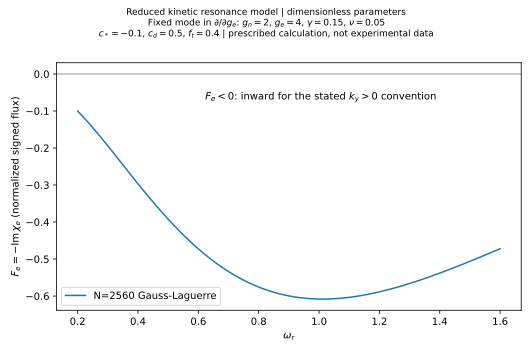
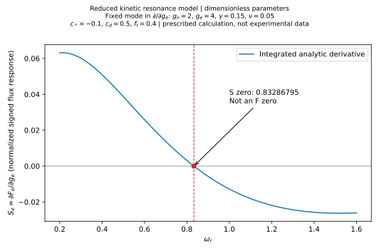
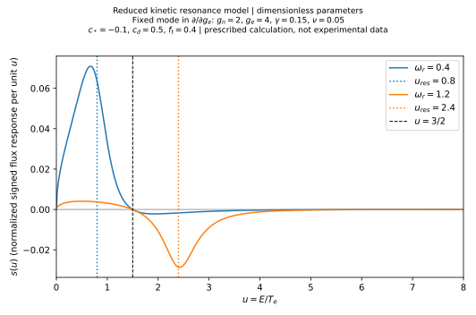

# FRA-04B1：电子非绝热响应与有符号粒子通量 / Reduced kinetic electron flux response

[文献目录 / Catalogue](../README.md) · [FRA-03](fra-03-transport-closure-identifiability.md) · [计算脚本 / Script](../../../scripts/research/fra04b1_electron_kinetic_flux.py) · [参数与环境 / Parameters](fra-04b1/parameters.json) · [核验明细 / Checks](fra-04b1/checks.json)

**中文** 本文是任务指定的 reduced kinetic resonance model 的实际数值计算记录，采用双语 11 节结构；不是 Fable 等论文的完整评议。结果属于给定模型下的独立数学与数值分析，不是实验观测或已验证的托卡马克输运规律。81 点扫描中，固定模态的温度梯度响应 $S_e$ 从正变负，而归一化有符号通量 $F_e$ 始终为负。

**EN** This is an executed calculation of the task-prescribed reduced kinetic resonance model, organized in eleven bilingual sections, rather than a full review of Fable et al. Results are mathematical and numerical analysis within the specified model, not experimental observations or validated tokamak transport laws. Across the 81-point scan, the fixed-mode temperature-gradient response $S_e$ changes from positive to negative while the normalized signed flux $F_e$ remains negative.

## 1. 来源与研究范围 / Sources and scope

**中文** 研究问题关联既有 `q-density`：温度梯度如何影响电子非绝热响应和粒子通量，及其与密度峰化推断之间还缺什么？主要物理背景为 Fable、Angioni 和 Sauter 的梯度驱动与波粒共振研究 [1]。本轮仅核对出版方页面的书目与摘要，并阅读 FRA-03 及其闭合讨论；未提供或阅读 [1] 全文、原始数据或代码，不声称复现其任何图或方程。以下积分、能量依赖、$f_t$、$\nu$、$\omega$ 均由本次任务指定，不能标成 [1] 的原文公式。

**EN** The existing `q-density` question motivates asking how temperature gradients affect the nonadiabatic electron response and particle flux, and what remains missing before inferring density peaking. Fable, Angioni and Sauter's work on gradient drives and wave–particle resonances provides physical context [1]. Only publisher metadata and the abstract were checked here, alongside reading FRA-03 and its closure discussion. No full text, original data or code for [1] was supplied or inspected; no figure or equation from that paper was reproduced. The integral, energy dependences, $f_t$, $\nu$ and $\omega$ below are prescribed by this task, not identified as equations from [1].

## 2. 为什么计算非绝热响应与通量符号 / Motivation and signed flux

**中文** 电子 Boltzmann 响应与电势同相，不贡献这里定义的交叉相位通量。因此直接积分复数非绝热响应，并保留其相位和通量符号。取 $x$ 向外、$y$ 双法向、$\mathbf B=B\hat z$、$B>0$、$k_y>0$，傅里叶约定为 $\exp[i(k_y y-\omega t)]$，$e>0$ 为元电荷大小。实场振幅平均给出：

**EN** The Boltzmann electron response is in phase with the potential and contributes no cross-phase flux under this definition. We therefore integrate the complex nonadiabatic response and preserve its phase and flux sign. Let $x$ point outward, $y$ be binormal, $\mathbf B=B\hat z$ with $B>0$, $k_y>0$, Fourier convention $\exp[i(k_y y-\omega t)]$, and $e>0$ the elementary-charge magnitude. Real-field amplitude averaging gives:

$$
v_{E,x}=-\frac{1}{B}\partial_y\phi,\qquad
\Gamma_e=\langle\delta n_e\delta v_{E,x}\rangle
=-\frac{k_y}{2B}\operatorname{Im}(\delta n_{e,k}\phi_k^*).
$$

$$
\delta n_{e,k}^{na}=n_e\frac{e\phi_k}{T_e}\chi_e,\qquad
\Gamma_e=\frac{n_e e k_y|\phi_k|^2}{2BT_e}F_e,\qquad
F_e=-\operatorname{Im}\chi_e.
$$

**中文** 上式采用与 $E\times B$ 速度定义一致的电势约定，$T_e$ 以能量表示。固定正 $k_y$ 时，$F_e>0$ 约定向外，$F_e<0$ 约定向内。本轮只计算无量纲 $F_e$，没有指定物理振幅和装置参数，不能报告 SI 粒子通量。

**EN** The potential convention is consistent with the stated $E\times B$ velocity and $T_e$ is an energy. For fixed positive $k_y$, positive $F_e$ denotes outward flux and negative $F_e$ inward flux. Only dimensionless $F_e$ is computed; without physical amplitudes and device parameters this is not an SI particle flux.

## 3. 模型、导数与复现方法 / Model, derivative and reproduction

For $u=E/T_e\geq0$ / 对于 $u=E/T_e\geq0$：

$$
w(u)=\frac{2}{\sqrt\pi}\sqrt{u}e^{-u},\quad
\int_0^\infty w(u)\,du=1,\quad
\omega_{*e}^T=c_*[g_n+(u-3/2)g_e],\quad
\omega_{de}=c_du,\quad\omega=\omega_r+i\gamma.
$$

$$
\chi_e=-f_t\int_0^\infty w(u)
\frac{\omega-\omega_{*e}^T(u)}{\omega-c_du+i\nu}\,du.\tag{1}
$$

$$
\left.\frac{\partial\chi_e}{\partial g_e}\right|_{g_n,\omega_r,\gamma,\nu,c_d,c_*,f_t}
=f_tc_*\int_0^\infty\frac{w(u)(u-3/2)}{\omega-c_du+i\nu}\,du,\qquad
S_e=-\operatorname{Im}\frac{\partial\chi_e}{\partial g_e}.\tag{2}
$$

| 输入 / Input                   | 数值 / Value                                      |
| ------------------------------ | ------------------------------------------------- |
| $g_n=R/L_{ne}$, $g_e=R/L_{Te}$ | 2.0, 4.0                                          |
| $c_*$, $c_d$, $f_t$            | −0.1, 0.5, 0.4                                    |
| $\gamma$, $\nu$                | 0.15, 0.05                                        |
| $\omega_r$                     | 0.2–1.6, 81 uniformly spaced points / 81 个均匀点 |
| Central differences / 中心差分 | $h=10^{-3},10^{-4}$                               |

**中文** 所有参数无量纲；$f_t$ 仅为指定参与响应权重，不是轨道计算所得俘获份额；$\nu\geq0$ 是现象学展宽。基准分母的虚部为 $\gamma+\nu=0.20$，分子虚部仍为 $\gamma=0.15$。扫描时改变 $\omega_r$；求 $g_e$ 导数时固定该点全部其他参数。模型没有 $g_i$ 输入，因此固定模态时 $\partial F_e/\partial g_i=0$ 是结构结果，不是 ITG 输运规律。

**EN** All parameters are dimensionless. The prescribed participation weight $f_t$ is not an orbit-calculated trapped fraction; $\nu\geq0$ is phenomenological broadening. The baseline denominator has imaginary part $\gamma+\nu=0.20$, while the numerator retains $\gamma=0.15$. The scan varies $\omega_r$; each $g_e$ derivative holds all other inputs fixed at that point. There is no $g_i$ input, so $\partial F_e/\partial g_i=0$ at fixed mode is structural, not an ITG transport law.

**中文** 实际环境：Python 3.14.7、NumPy 2.5.4、SciPy 1.18.1、Matplotlib 3.11.2，float64/complex128。在仓库根目录使用已安装这些库的 Python，一次运行生成全部 JSON、CSV 和 SVG；建议先输出到独立科研工作区，再核对并复制正式成果。将下述 `OUTPUT_DIRECTORY` 替换为输出路径：

**EN** Executed environment: Python 3.14.7, NumPy 2.5.4, SciPy 1.18.1, Matplotlib 3.11.2, float64/complex128. From the repository root, a Python with these libraries regenerates all JSON, CSV and SVG files in one run. Prefer an external task workspace before checking and copying public artifacts. Replace `OUTPUT_DIRECTORY` with the output path:

```bash
python scripts/research/fra04b1_electron_kinetic_flux.py --output-dir OUTPUT_DIRECTORY
```

**中文** 输入及环境见 [parameters.json](fra-04b1/parameters.json)，含统一 LF 换行后的脚本 SHA-256。完整复数响应、解析导数、两种差分及绝对误差见 [scan.csv](fra-04b1/scan.csv)。额外代表频率单独积分，未将预计算参考值作为程序输出。

**EN** [parameters.json](fra-04b1/parameters.json) records inputs, environment and the script SHA-256 after LF normalization. [scan.csv](fra-04b1/scan.csv) contains the complex response, integrated analytic derivative, both differences and absolute errors. Additional representative frequencies were separately integrated; supplied reference answers were not used as output.

## 4. 实际结果与局部主张 / Results and local claims

**中文** 下表采用 2560 阶 Gauss–Laguerre 积分，显示 9 位小数；自适应积分差值与完整精度保存在 JSON/CSV。数字精度仅指本模型的数值一致性。

**EN** Values below use 2560-point Gauss–Laguerre quadrature, displayed to nine decimal places. Adaptive differences and full numerical precision are retained in JSON/CSV. Precision describes numerical agreement within this model only.

| $\omega_r$ | $\operatorname{Re}\chi_e$ | $\operatorname{Im}\chi_e$ | $F_e$        | $S_e$        |
| ---------- | ------------------------- | ------------------------- | ------------ | ------------ |
| 0.2        | 0.078548269               | 0.100235818               | −0.100235818 | +0.063083107 |
| 0.4        | 0.113046215               | 0.296736129               | −0.296736129 | +0.050918221 |
| 1.0        | −0.268435529              | 0.608067681               | −0.608067681 | −0.012778142 |
| 1.2        | −0.401828723              | 0.588729938               | −0.588729938 | −0.021879748 |
| 1.6        | −0.579950604              | 0.472159152               | −0.472159152 | −0.026105718 |

| 局部主张 / Local claim                                                         | 依据与条件 / Evidence and conditions                                                                           | 性质与核查边界 / Type and checking limits                                                                                                     |
| ------------------------------------------------------------------------------ | -------------------------------------------------------------------------------------------------------------- | --------------------------------------------------------------------------------------------------------------------------------------------- |
| C01: $S_e$ changes sign / $S_e$ 改变符号                                       | Eqs. (1)–(2), baseline inputs, `checks.json:S_zero`, convergence CSV / 式（1）—（2）、基准参数及零点、收敛记录 | Executed numerical result; fixed mode only / 已执行数值结果，仅固定模态                                                                       |
| C02: no $F_e$ sign reversal observed / 未见 $F_e$ 符号反转                     | All 81 `scan.csv` points negative; root value also negative / 81 个扫描点及响应零点处均为负                    | Numerical scan, not a proof excluding unsampled or tangential zeros / 数值扫描，不是排除未采样或切触零点的证明                                |
| C03: energy cancellation explains the response reversal / 能量抵消解释响应反转 | Eq. (3), energy density and contribution CSVs at 0.4 and 1.2 / 式（3）及两频率能量 CSV                         | Algebra plus independently integrated real densities within this model; no experimental verification / 模型内代数及实密度独立积分，无实验验证 |

**中文** 自适应积分函数结合 `brentq` 得 $\omega_{r,S=0}=0.8328679499979597$；2560 阶实际积分函数定位为 0.8328679499979398。稳妥报告 **0.83286795**。在自适应零点处，$F_e=-0.5854598432311513$，$S_e$ 残差约 $3.6\times10^{-18}$；左右 $10^{-4}$ 处 $S_e$ 分别为 $+9.1773861\times10^{-6}$ 和 $-9.1755487\times10^{-6}$。扫描的 $F_e$ 范围约为 [−0.608124897, −0.100235818]。这是响应零点，不是粒子通量零点。

**EN** Applying `brentq` to the adaptive integral gives $\omega_{r,S=0}=0.8328679499979597$; applying it to the 2560-point integral gives 0.8328679499979398. We conservatively report **0.83286795**. At the adaptive root, $F_e=-0.5854598432311513$ and the $S_e$ residual is about $3.6\times10^{-18}$. At offsets of $-10^{-4}$ and $+10^{-4}$, $S_e$ is $+9.1773861\times10^{-6}$ and $-9.1755487\times10^{-6}$, respectively. The sampled $F_e$ range is approximately [−0.608124897, −0.100235818]. This is a response zero, not a particle-flux zero.





## 5. 数值方法与最小核验 / Numerical methods and checks

**中文** 广义 Gauss–Laguerre 取 $\alpha=1/2$，权重除以 $\Gamma(3/2)$。40–320 阶使用 `roots_genlaguerre`；640、1280、2560 阶使用同一 Laguerre Jacobi 三对角矩阵的 Golub–Welsch 求积，归一化权重为特征向量首分量的平方，避免高阶多项式求值溢出。独立 `quad` 将复数实虚部分别在 $[0,\infty)$ 积分，绝对／相对容差均 $2\times10^{-12}$、`limit=400`。所有非有限求积结果、积分警告或失败断言均中止运行，不用于根定位。

**EN** Generalized Gauss–Laguerre uses $\alpha=1/2$ and weights divided by $\Gamma(3/2)$. Orders 40–320 use `roots_genlaguerre`; orders 640, 1280 and 2560 use Golub–Welsch on the same Laguerre Jacobi tridiagonal matrix. Normalized weights are squared first eigenvector components, avoiding high-order polynomial overflow. Independent `quad` integrates real and imaginary parts separately over $[0,\infty)$, with absolute and relative tolerances $2\times10^{-12}$ and `limit=400`. Nonfinite rules, integration warnings and failed assertions stop execution before being used as root results.

| 核验 / Check                           | 实际结果 / Actual result                                                                                   |
| -------------------------------------- | ---------------------------------------------------------------------------------------------------------- |
| V1: normalized Maxwellian / 权重归一化 | Quad: 0.9999999999999996; all eight GL orders within $9\times10^{-16}$ / 八阶 GL 偏差均小于该值            |
| V2: $f_t=0$                            | $\chi_e=F_e=S_e=0$ at three frequencies / 三频率均为零                                                     |
| V3: real kernel / 实核                 | $c_d=\nu=\gamma=0$, nonzero $\omega_r$: $F_e=S_e=0$ at three frequencies / 三频率验证为零                  |
| V4: derivative / 导数                  | Both finite differences checked at all 81 frequencies / 两步长均核对全部 81 频率                           |
| V5: ion gradient / 离子梯度            | No $g_i$ in schema or Eqs. (1)–(2); derivative zero by construction / 参数及公式均无 $g_i$，导数结构性为零 |
| V6: convergence / 收敛                 | Eight GL orders against independent quad; see section 6 / 八阶与独立 quad 比较，见第 6 节                  |
| V7: zero and signs / 零点与符号        | Positive left, negative right for $S_e$; $F_e<0$ at root and all scan points / 响应左正右负，通量为负      |

**中文** $h=10^{-3}$ 与 $10^{-4}$ 的最大导数绝对差分别为 $1.022\times10^{-13}$、$1.001\times10^{-12}$。本模型对 $g_e$ 是仿射函数，中心差分不存在通常的非零截断项；步长更小时误差反而因相消和舍入增大。这不构成一般非线性模型的差分收敛阶验证。只取 $c_d=\nu=0$ 但保留 $\gamma>0$ 时分子仍有相位差，一般不能要求通量为零。共 41 项执行断言通过，包括能量重构；见 `checks.json`。断言数量本身不是物理证据。

**EN** Maximum derivative differences are $1.022\times10^{-13}$ for $h=10^{-3}$ and $1.001\times10^{-12}$ for $h=10^{-4}$. Since the model is affine in $g_e$, the centered difference has no nonzero truncation term; cancellation and rounding increase the error at the smaller step. This does not establish a difference convergence order for nonlinear models. Setting only $c_d=\nu=0$ while retaining $\gamma>0$ generally leaves a phase difference and need not give zero flux. All 41 executed assertions pass, including energy reconstruction; see `checks.json`. Their count is not physical evidence.

## 6. 求积收敛及新增认识 / Quadrature convergence and contribution

Errors below are maxima over the 81 scan points relative to quad / 下表误差为 81 点相对 quad 的最大值：

| $N$  | $\max\lvert\Delta\chi_e\rvert$ | $\max\lvert\Delta S_e\rvert$ | $\omega_{r,S=0}$ | Root shift vs quad / 零点偏移 |
| ---- | ------------------------------ | ---------------------------- | ---------------- | ----------------------------- |
| 40   | 6.528×10⁻²                     | 4.345×10⁻³                   | 0.846037362378   | +1.317×10⁻²                   |
| 80   | 1.922×10⁻²                     | 1.292×10⁻³                   | 0.835210757082   | +2.343×10⁻³                   |
| 160  | 3.656×10⁻³                     | 2.364×10⁻⁴                   | 0.833054590535   | +1.866×10⁻⁴                   |
| 240  | 1.031×10⁻³                     | 6.775×10⁻⁵                   | 0.832820889843   | −4.706×10⁻⁵                   |
| 320  | 3.537×10⁻⁴                     | 2.094×10⁻⁵                   | 0.832857428415   | −1.052×10⁻⁵                   |
| 640  | 1.295×10⁻⁵                     | 7.794×10⁻⁷                   | 0.832867852219   | −9.778×10⁻⁸                   |
| 1280 | 1.205×10⁻⁷                     | 6.516×10⁻⁹                   | 0.832867949994   | −4.381×10⁻¹²                  |
| 2560 | 1.615×10⁻¹⁰                    | 8.419×10⁻¹²                  | 0.832867949998   | −1.987×10⁻¹⁴                  |

**中文** [convergence.csv](fra-04b1/convergence.csv) 还保存通量误差、逐阶零点偏移及权重误差。最终通量最大差为 $1.162\times10^{-10}$。将 quad 容差再收紧至 $2\times10^{-13}$，零点改变约 $2.6\times10^{-15}$；扫描中 quad 自报最大分量误差估计约 $1.99\times10^{-12}$。这些是数值诊断，不是严格误差界或物理不确定度。1280 阶在零点附近很准，但扫描高频端的复响应误差仍约 $10^{-7}$；因此正式 CSV 采用 2560 阶，而没有仅凭一个零点宣布整段收敛。

**EN** [convergence.csv](fra-04b1/convergence.csv) also records flux errors, changes between successive roots and weight errors. The final maximum flux difference is $1.162\times10^{-10}$. Tightening quad tolerances to $2\times10^{-13}$ changes the root by about $2.6\times10^{-15}$; the largest reported component error estimate in the adaptive scan is about $1.99\times10^{-12}$. These are diagnostics, not rigorous bounds or physical uncertainties. Although order 1280 is accurate near the root, the complex-response error at the high-frequency end is still about $10^{-7}$; published CSV values therefore use order 2560 rather than inferring convergence everywhere from one root.

**中文** 相对 FRA-03 的抽象切线闭合，本轮新增一个实际复响应积分算例，显示“温度梯度响应变号”与“通量变号”的区别，并用加权能量贡献解释。尚未评价相对 [1] 或完整动理学文献的理论创新性；未完成该全文及前序文献评议。

**EN** Relative to FRA-03's abstract tangent closure, this calculation adds an executed complex-response example separating response-sign reversal from flux-sign reversal, with a weighted energy-space explanation. Theoretical novelty relative to [1] or the full kinetic literature is not assessed; full-text and prior-literature review remain incomplete.

## 7. 能量空间解释与局限 / Energy interpretation and limitations

Let $\eta=\gamma+\nu>0$ and $D=(\omega_r-c_du)^2+\eta^2$ / 取 $\eta=\gamma+\nu>0$，$D=(\omega_r-c_du)^2+\eta^2$：

$$
f(u)=-\operatorname{Im}\left[-f_tw(u)\frac{\omega-\omega_{*e}^T}{\omega-c_du+i\nu}\right]
=\frac{f_tw(u)\{\gamma(\omega_r-c_du)-\eta[\omega_r-\omega_{*e}^T(u)]\}}{D},
$$

$$
s(u)=-\operatorname{Im}\left[\frac{f_tc_*w(u)(u-3/2)}{\omega-c_du+i\nu}\right]
=\frac{f_tc_*\eta\,w(u)(u-3/2)}{D}.\tag{3}
$$

**中文** 两者都含 Maxwellian 权重，分别满足 $\int f\,du=F_e$、$\int s\,du=S_e$。基准 $c_*<0$ 时 $s(u)$ 在 $u<1.5$ 为正、$u>1.5$ 为负，分母在 $u_{res}=\omega_r/c_d$ 附近增强贡献；$u_{res}$ 是展宽分母的中心，不必等于加权密度的极值点。共振中心由 0.8 移至 2.4 时，正能区优势变为负能区优势。抵消零点对应 $u_{res}\simeq1.6657359$，并非简单的 $u_{res}=1.5$ 阈值，因为要积分整个加权能量分布。

**EN** Both densities include the Maxwellian weight and satisfy $\int f\,du=F_e$ and $\int s\,du=S_e$. With baseline $c_*<0$, $s(u)>0$ below $u=1.5$ and $s(u)<0$ above it. The denominator enhances contributions near $u_{res}=\omega_r/c_d$, the center of the broadened denominator rather than necessarily the maximum of a weighted density. Moving this center from 0.8 to 2.4 shifts dominance from the positive to the negative region. Cancellation occurs at $u_{res}\simeq1.6657359$, not a simple threshold $u_{res}=1.5$, because the entire weighted energy distribution contributes.

| $\omega_r$ | $u_{res}$ | $\int_{u<1.5}s\,du$ | $\int_{u>1.5}s\,du$ | Sum / 合计      |
| ---------- | --------- | ------------------- | ------------------- | --------------- |
| 0.4        | 0.8       | +0.054170752311     | −0.003252531201     | +0.050918221110 |
| 1.2        | 2.4       | +0.004461244909     | −0.026340993383     | −0.021879748475 |

| $\omega_r$ | $f(u)$ zero / 零点 | $\int\max(f,0)\,du$ | $\int\min(f,0)\,du$ | Sum / 合计      |
| ---------- | ------------------ | ------------------- | ------------------- | --------------- |
| 0.4        | 0.387096774194     | +0.010619278974     | −0.307355408089     | −0.296736129115 |
| 1.2        | 0.129032258065     | +0.000074652192     | −0.588804590278     | −0.588729938085 |

**中文** [energy-contributions.csv](fra-04b1/energy-contributions.csv) 保存正负部分的独立自适应积分；其和与复积分的 $F_e,S_e$ 差均小于 $10^{-15}$（仅舍入级一致性）。[energy-densities.csv](fra-04b1/energy-densities.csv) 保存 $u=0$–24 的实际 $f(u),s(u)$，每频率 1601 点。图显示 0–8；正式积分始终为 0–∞，没有用绘图网格求积。24 以上尾部通量绝对值小于 $2.6\times10^{-12}$，响应小于 $3.2\times10^{-13}$。

**EN** [energy-contributions.csv](fra-04b1/energy-contributions.csv) contains independently adapted positive and negative integrals; their sums agree with the complex-integral $F_e,S_e$ within $10^{-15}$, at rounding scale only. [energy-densities.csv](fra-04b1/energy-densities.csv) contains actual $f(u),s(u)$ on 1601 points per frequency from 0 to 24. The figure displays 0–8; all reported integrals span 0–∞ and do not use the plotting grid for quadrature. Beyond 24, the absolute flux tail is below $2.6\times10^{-12}$ and response tail below $3.2\times10^{-13}$.



**中文** 模型未包含真实磁几何、俯仰角和轨道平均、俘获／通过粒子区分、碰撞算符、有限拉莫尔半径、平行流动、离子动力学、准中性本征模求解、模态谱、电势振幅及非线性饱和。$\omega$、$\gamma$ 和 $f_t$ 外加，$\nu$ 不能代替守恒碰撞算符。因此不能按 $\omega_r$ 符号直接判定 ITG/TEM，也不能据此判断 HL-3 主导湍流。未搜索或使用该装置历史实验数据。

**EN** Missing physics includes realistic magnetic geometry, pitch angle and orbit averaging, trapped/passing separation, a collision operator, finite Larmor radius, parallel streaming, ion dynamics, a quasineutral eigenmode solution, mode spectra, potential amplitude and nonlinear saturation. The imposed $\omega$, $\gamma$ and $f_t$, and phenomenological $\nu$, do not supply those ingredients. The sign of $\omega_r$ cannot directly classify ITG/TEM, nor can this model identify the dominant turbulence in HL-3. No historical experimental data for that device were searched or used.

## 8. 与密度峰化和 FRA-03 的联系 / Density peaking and FRA-03

$$
\left.\frac{\partial F_e}{\partial g_e}\right|_{\text{fixed mode}}
\ne\frac{\partial(R/L_{ne})}{\partial(R/L_{Te})}.
$$

**中文** 左侧只是给定模态的局部通量导数。若另有可微的完整总通量闭合 $\mathcal F(g_n,g_e,\ldots)=\Gamma_{req}$，且固定其他变量、源与边界并满足 $\mathcal F_{g_n}\ne0$，隐函数关系才给 $dg_n/dg_e=-\mathcal F_{g_e}/\mathcal F_{g_n}$。真实问题还可能需要模态、振幅及其他状态变量对梯度的自洽响应。本轮既未给完整闭合，也未施加粒子平衡，所以 $S_e=0$ 不表示密度峰化极值或零通量。这具体化了 FRA-03 中“切线响应不等于完整闭合”的边界。

**EN** The left side is only a local flux derivative for an imposed mode. If a differentiable complete total-flux closure $\mathcal F(g_n,g_e,\ldots)=\Gamma_{req}$ were available, with other variables, sources and boundaries fixed and $\mathcal F_{g_n}\ne0$, implicit differentiation would give $dg_n/dg_e=-\mathcal F_{g_e}/\mathcal F_{g_n}$. Real systems may also require self-consistent changes of modes, amplitudes and coupled state variables. Neither a complete closure nor particle balance is supplied here; $S_e=0$ therefore implies neither an extremum of density peaking nor zero flux. This makes concrete FRA-03's distinction between a tangent response and a complete closure.

## 9. 跨学科研究机会 / Cross-disciplinary opportunity

**中文** 数值分析的具体问题是：对有限展宽复极点附近的加权积分，如何在整个参数区间控制响应与导数误差，而不是只检查某个根？本轮的阶数扫描与独立积分给出一个可复现案例；高频端误差和零点误差不同步下降，提示应同时检验完整响应和根。尚无面向任意展宽、几何或谱的统一误差保证。

**EN** A concrete numerical-analysis question is how to control both response and derivative errors across a parameter interval for weighted integrals near broadened complex poles, rather than checking only a root. The order scan and independent quadrature provide a reproducible example: high-frequency response errors and root errors decrease differently, motivating checks of both. No uniform guarantee for arbitrary broadening, geometry or spectra is established.

## 10. 下一步验证与缺少输入 / Future verification and missing inputs

**中文** 以下仅为证据缺口，不在本轮执行：若要联系真实密度峰化，需要公开、获准使用的几何和平衡、粒子源与边界、密度温度剖面及协方差、碰撞参数，以及可检查的本征模／非线性通量计算。应比较固定背景的梯度导数与自洽模态变化后的总导数，并在留出条件下预测有符号通量和粒子平衡。本轮结果不能替代这些输入或验证。

**EN** These are evidence gaps, not tasks executed here. Connecting to real density peaking requires authorized public geometry/equilibrium, particle sources and boundaries, density/temperature profiles and covariance, collision parameters, and inspectable eigenmode/nonlinear flux calculations. Fixed-background gradient derivatives should be compared with total derivatives including self-consistent mode changes, with signed flux and particle balance predicted in withheld conditions. This calculation does not replace those inputs or checks.

## 11. 实际状态与参考资料 / Status and references

**中文** 记录日期：2026-10-24。已实际运行能量积分、81 点扫描、两步长差分、八阶求积、独立自适应积分、真实函数零点定位及能量正负分解；结果与任务给出的外部预计算在显示精度内一致，但该预计算的原始程序和环境未审计。源论文完整研读与独立物理验证均未完成。没有新增或复用为新记录的 source/finding ID，没有图谱改动或状态提升；文献统计保持 5 / 5 / 0。C01–C03 仅为本文局部分析标签。

**EN** Record date: 2026-10-24. Energy integration, the 81-point scan, two difference steps, eight quadrature orders, independent adaptive integration, actual-function root finding and signed energy decomposition were executed. Results agree at displayed precision with the task's external precalculation, whose underlying code and environment were not audited. Full-paper study and independent physical verification remain unperformed. No source/finding IDs were added or repurposed into new records; graph data and states are unchanged, with literature counts 5 / 5 / 0. C01–C03 are local analysis labels only.

1. Fable, E., Angioni, C. & Sauter, O. The role of ion and electron electrostatic turbulence in characterizing stationary particle transport in the core of tokamak plasmas. _Plasma Phys. Control. Fusion_ **52**, 015007 (2010). [DOI and publisher page](https://doi.org/10.1088/0741-3335/52/1/015007). **Actual scope / 实际范围：** publisher metadata and abstract, checked 2026-10-24; full text, figures, numbered equations, data and code not inspected / 仅出版方书目与摘要，未查全文、图、编号方程、数据或代码。
2. [FRA-03: Transport-closure identifiability / 输运闭合可辨识性](fra-03-transport-closure-identifiability.md), especially sections 5 and 10–11 / 尤其第 5、10–11 节。Repository analysis consulted; its cited original papers were not reread here / 已阅读仓库分析，本轮未重读其所引原文。
